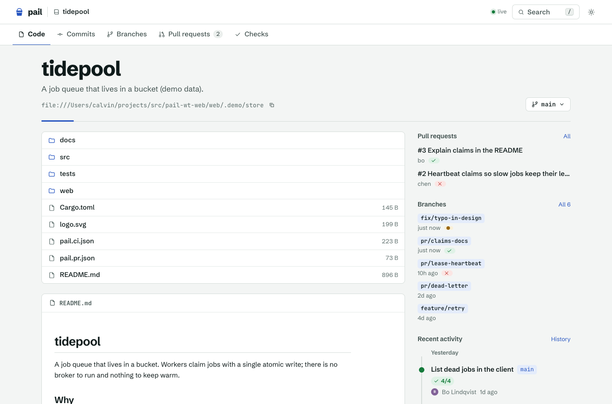
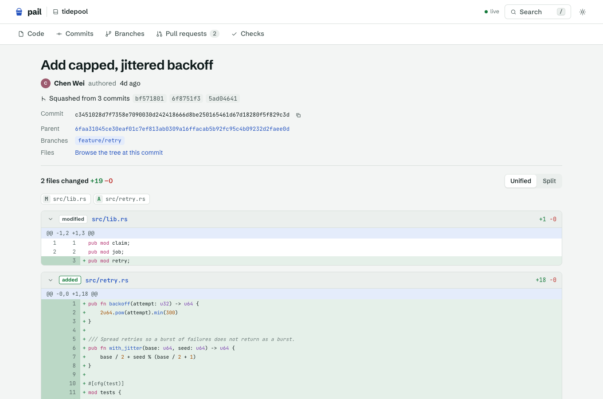
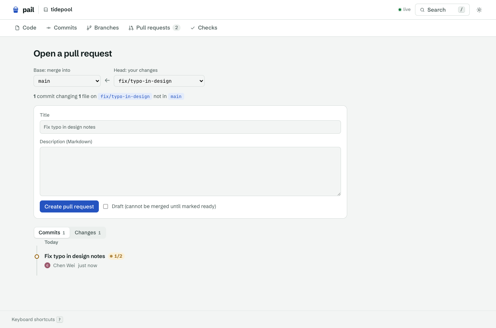
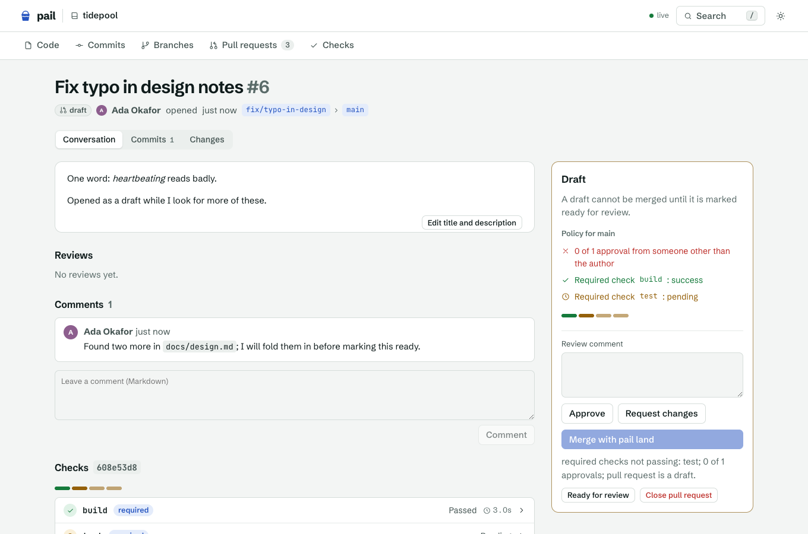

# pail-web

A web UI for browsing [pail](../README.md) repositories: code, commits and diffs, pull requests, and
CI checks, read straight from the bucket. Open source (MIT, see [LICENSE](LICENSE)); it depends on
nothing in this repository except the `pail` binary and pail's on-bucket conventions.



## Quick start

```sh
cd web
npm install
npm run demo        # builds a local demo repository with your pail binary, serves it on :4747
```

`npm run demo` needs `pail` on your `PATH` (or `PAIL_BIN=/path/to/pail`, or a `cargo build --release`
of this checkout, which it finds on its own). It creates `web/.demo/` and needs no configuration.

Point it at your own repositories:

```sh
cp pail-web.config.example.json pail-web.config.json    # edit the repos
npm run build && npm start                               # http://127.0.0.1:4747
# or, without a file:
PAIL_WEB_REPOS="app=gs://acme-vcs/app,infra=s3://acme-vcs/infra" npm start
npm run dev         # API with reload, plus Vite with hot reload on :5173
```

Docker (from the repository root; the image builds pail from this checkout, so the CLI matches the UI):

```sh
docker build -t pail-web -f web/Dockerfile .
docker run -p 4747:4747 -e PAIL_WEB_REPOS="app=gs://bucket/app" \
  -v ~/.config/gcloud:/home/node/.config/gcloud:ro pail-web     # GCS credentials; use AWS_* env for S3
```

## Configuration

One file, `pail-web.config.json` (in the working directory, or `PAIL_WEB_CONFIG=path`), with
environment overrides. Defaults < file < environment < flags (`--config`, `--store`, `--port`, `--actions`).

```json
{
  "port": 4747,
  "host": "127.0.0.1",
  "actions": false,
  "repos": [
    { "name": "app", "store": "gs://acme-vcs/app", "description": "The main application" },
    { "name": "infra", "store": "s3://acme-vcs/infra" },
    { "name": "scratch", "store": "file:///var/pail/scratch" },
    { "name": "shared", "store": "https://pail.example.com/shared", "tokenEnv": "PAIL_WEB_SHARED_TOKEN" }
  ],
  "discover": [{ "store": "gs://acme-vcs" }]
}
```

| Key | Meaning |
|---|---|
| `repos[].store` | `gs://`, `s3://`, `file://`, or a `pail serve` `https://host/repo` |
| `repos[].tokenEnv` / `token` | bearer token for an `https://` store (prefer `tokenEnv`; it never reaches argv or the UI) |
| `repos[].env` | extra environment for that repo's pail processes, e.g. `{"AWS_PROFILE": "ci"}` |
| `discover[].store` | a bucket prefix or directory: each child that is a pail repository is listed (needs `gcloud` or `aws` on `PATH` for `gs://` and `s3://`; `file://` needs nothing) |
| `actions` | `true` enables the write side: open, edit, comment on, review, close, reopen and merge pull requests (off by default; the UI is read-only) |
| `author` | identity for actions, `Name <email>` (else `PAIL_AUTHOR`) |
| `pail` | the binary (default: `pail` on `PATH`, else this checkout's `target/release/pail`; also `PAIL_BIN`). The server exits at startup if it cannot run it |
| `cacheDir`, `localCache` | where bare clones live and whether to use them (see Caching) |
| `cacheMb`, `pollMs` | in-memory cache size (128) and `pail events` poll interval (2000) |

Environment: `PAIL_WEB_CONFIG`, `PAIL_WEB_PORT`, `PAIL_WEB_HOST`, `PAIL_WEB_REPOS` (`name=url,name=url`),
`PAIL_WEB_DISCOVER`, `PAIL_WEB_ACTIONS`, `PAIL_WEB_AUTHOR`, `PAIL_WEB_CACHE_DIR`, `PAIL_WEB_LOCAL_CACHE`
(`auto`/`on`/`off`), `PAIL_BIN`. With none of these, `PAIL_STORE` names a single repository.

**Credentials come from the environment, the way the pail CLI takes them:** gcloud login or
`GOOGLE_APPLICATION_CREDENTIALS` / `PAIL_GCS_TOKEN` for GCS, the AWS chain for S3, `pail auth`
providers for anything else. The server runs the CLI as you; it has no auth of its own, so bind it
to localhost or put it behind your own proxy (`PAIL_WEB_HOST=0.0.0.0` exposes it).

## How it works

```
 browser ── React (Vite) ──▶ /api/*  ──▶ Express ──▶ spawn `pail --store <url> …` ──▶ bucket
    ▲                                       │  memory cache (by commit id) + bare-clone cache
    └───────── SSE /api/repos/:r/events ◀── `pail events` (one process per watched repo)
```

| View | pail command |
|---|---|
| branches | `branch --json` (the only mutable read; 3 s TTL, dropped on every ref event) |
| history, commit | `log --json [--maintenance] [-n N --skip S] <commit> [-- path]` |
| commit diff | `show <commit> --pretty=format: -p` |
| tree, file | `ls -l <commit>:<dir>`, `cat-file -s/-p <commit>:<path>`, `ls -r <commit>` |
| PRs, reviews, comments, checks | `ls -r _meta:prs`, `cat-file --batch` over `_meta:prs/<n>.json`, `…/reviews/*.json`, `…/comments/*.json`, `_meta:checks/<commit>/*.json` |
| compare, PR diff | `log --name-only base..head`, then the blobs on both sides, diffed in Node |
| policy, CI | `<base>:pail.pr.json`, `<commit>:pail.ci.json` |
| live updates | `events` → Server-Sent Events |
| actions | `put _meta --file prs/<n>.json=- [--if-absent]` (open, edit, close, reopen, draft), `…/comments/<ms>-<who>.json=- --if-absent`, `…/reviews/<who>.json=-`, `land <head> --stack --onto <base>` |

Two small CLI additions made this possible without parsing human text: `pail log --json` (pail ids and
commit `meta`: `pail.maintenance`, `rewritten.from`, `landed.from`) and `pail branch --json`.

### Caching

Commits, trees and blobs are named by hash and never change, so everything addressed by a commit id is
cached forever (byte-budgeted LRU, concurrent identical reads coalesced into one process). Only refs are
re-read, and `pail events` tells the server when they move; the browser is told over SSE and refetches.
Responses for commit ids carry `Cache-Control: immutable`.

For remote stores the server also keeps a **bare clone per repository** in `cacheDir`
(`~/.cache/pail-web`) and reads trees, files and diffs through it, so pages pail has seen are not
fetched twice, even across restarts. This matters on large repositories: see Performance below.

## Features

- **Repositories**: list, home with the README rendered, file tree, branches, pull requests, recent activity.
- **Code**: tree and file view with syntax highlighting (grammars load on demand), line anchors
  (`#L12-L20`), Markdown preview, images, raw and download, a branch or commit switcher
  (branch names may contain slashes), history of a path. pail has no blame, so there is none here.
- **Commits**: paginated log, commit page with unified or split diff, maintenance (repack) commits hidden
  behind a toggle, "squashed from" and "rewritten from" links from `rewritten.from`, "landed from" from `landed.from`.
- **Pull requests** (`_meta:prs/<n>.json`): open, merged, closed filters and a draft state; description,
  reviews, comments, checks, commits, diff against the base, and the merge policy from
  `<base>:pail.pr.json` with what is missing. Everything the `pail pr` plugin writes shows here, live.
- **CI**: results per commit (`_meta:checks/<commit>/<check>.json`) with the log tail, declared checks
  (`pail.ci.json`), required versus optional, and status badges on commits, branches and PRs.
- **Actions** (opt-in, `"actions": true`): on a branch, **Compare & open pull request** leads to a compare
  page (base...head: commits and diff, then title, description and draft, then create). On a pull request:
  comment, approve or request changes, edit the title and description, mark ready or back to draft, close
  and reopen, and merge with `pail land --stack`. Each is one `pail put` of the same record
  [`pail pr`](../docs/extending.md) writes (ids claimed with `--if-absent`, retried on a clash), so a PR
  opened in the terminal is live here and the other way around.
- **Keyboard**: `t` find a file, `/` search files, branches and PRs, `g c|b|p|k|h` go to commits, branches,
  pull requests, checks, home; `?` lists them. Light and dark themes (follows the system, toggle in the bar).



Opening a pull request (with actions on), and a draft with a comment:




## Develop

```sh
npm run dev          # API on :4747 (tsx watch) and Vite on :5173, proxied
npm run typecheck
npm test             # vitest: API, components, and an end-to-end smoke over the demo repository
npm run shots        # screenshots into docs/screenshots (needs agent-browser and a running server;
                     # with PAIL_WEB_ACTIONS=1 it also shoots the compare page and a draft PR)
```

`test/plugin.test.ts` drives the real `pail pr` plugin (needs `python3`) and the API against one store, in both
directions. The tests build the demo repository with the real `pail` binary (`PAIL_BIN`, else this checkout's
`target/release/pail`, else `PATH`). Layout: `server/` (Express, the pail runner, caches), `src/`
(React), `shared/` (API types), `scripts/` (demo data), `test/`.

## Security notes

- Everything is read-only unless `"actions": true`. With it, writes are `pail put`/`pail land` commands run
  with an argument list (no shell). Branch names must exist in the repository, may not start with `-` or `_`,
  titles are one line of at most 256 characters, bodies and comments at most 60,000; ids and numbers are
  integers; names used as file names are reduced to `[A-Za-z0-9._-]`. There is no per-user auth: whoever
  can reach the server acts as `author`, so keep it on localhost or behind your own proxy.
- Repository text is untrusted: Markdown is sanitized (DOMPurify), and `/raw` serves plain text or
  images with `nosniff` and a sandbox CSP, so a repo cannot run script in this origin.
- Refs and paths from the URL are validated before they reach the CLI; no shell is involved.
- Tokens stay in the server's environment and are never sent to the browser (store URLs are redacted).
